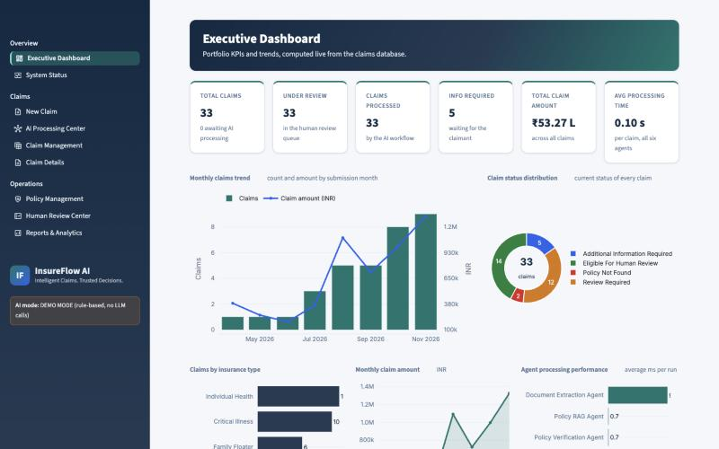
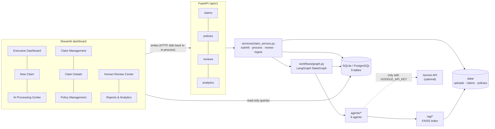
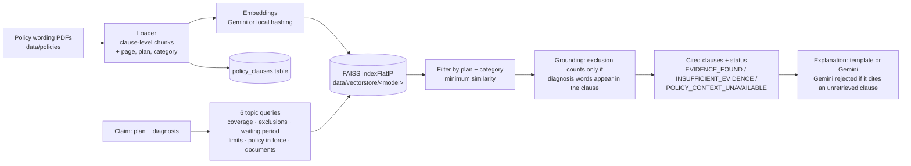
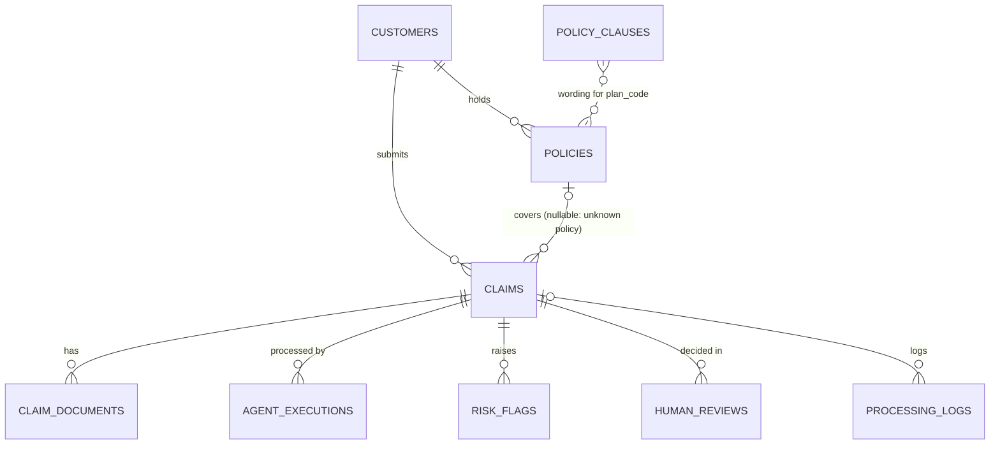
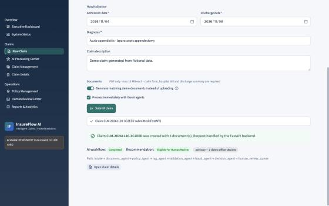
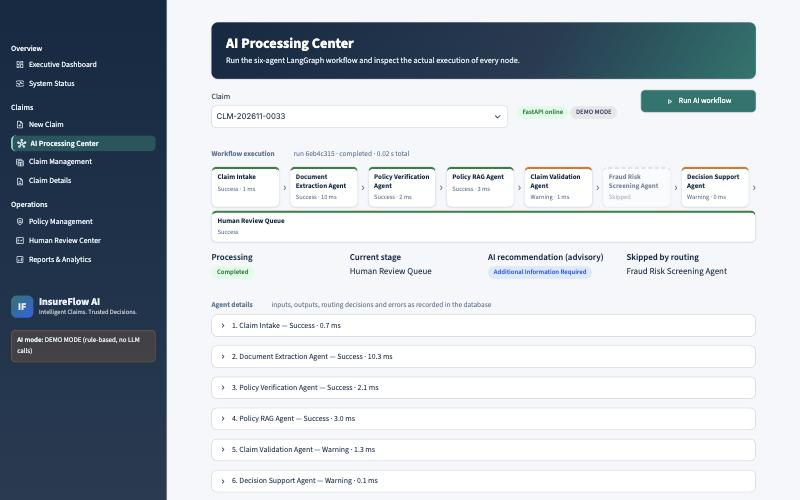
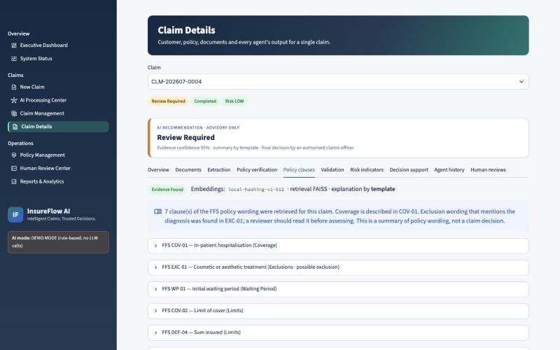
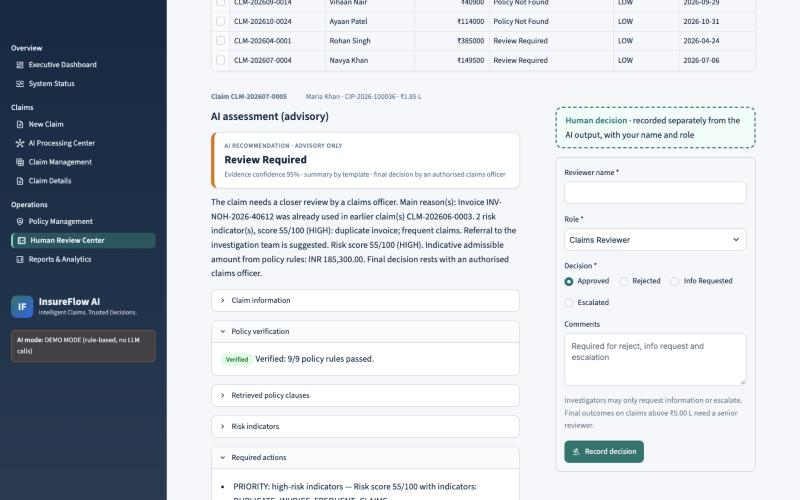
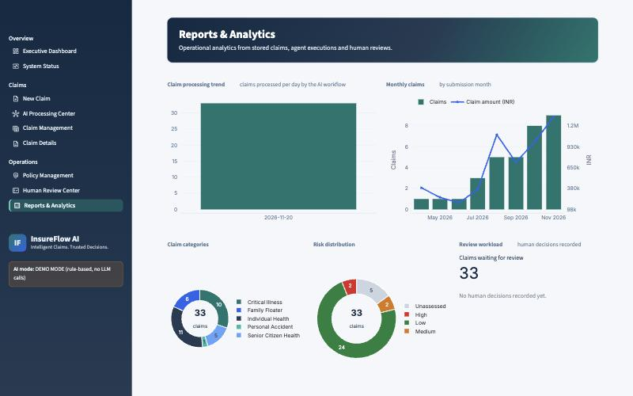
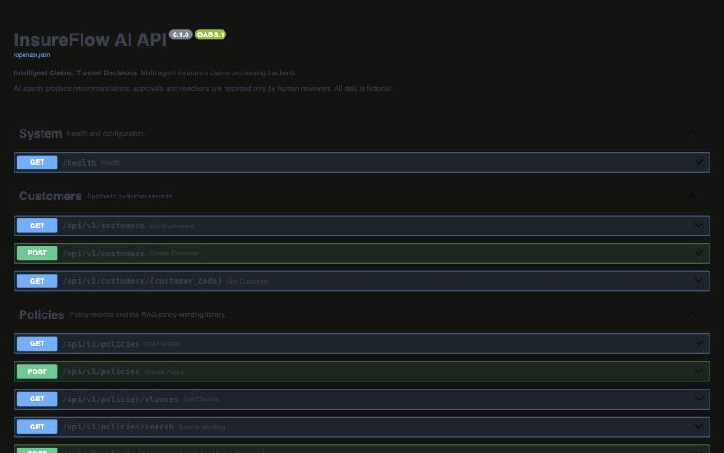

# InsureFlow AI

### Intelligent Claims. Trusted Decisions.

An intelligent multi-agent insurance claims processing platform built with **Python, LangGraph, LangChain, Gemini, RAG, FastAPI and Streamlit**.

Six cooperating AI agents read claim documents, verify the policy, retrieve the relevant policy wording, validate the claim, screen for risk indicators and prepare a **recommendation** for a human claims officer. The system never approves or rejects a claim by itself: final decisions are recorded only by authorised people in the Human Review Center.

> All customers, policies, hospitals, claims and documents in this repository are **fictional**. Policy wording is synthetic and is not a real insurance contract.



---

## Table of contents
1. [Project overview](#1-project-overview)
2. [Business problem](#2-business-problem)
3. [Key features](#3-key-features)
4. [Technology stack](#4-technology-stack)
5. [System architecture](#5-system-architecture)
6. [Agent architecture](#6-agent-architecture)
7. [LangGraph workflow](#7-langgraph-workflow)
8. [RAG architecture](#8-rag-architecture)
9. [Database design](#9-database-design)
10. [Installation guide](#10-installation-guide)
11. [Environment configuration](#11-environment-configuration)
12. [How to run the application](#12-how-to-run-the-application)
13. [How to execute tests](#13-how-to-execute-tests)
14. [Screenshots](#14-screenshots)
15. [Limitations](#15-limitations)
16. [Future improvements](#16-future-improvements)

---

## 1. Project overview

InsureFlow AI processes health-insurance claims end to end:

1. A claimant (or operator) submits a claim with PDF documents: claim form, hospital bill, discharge summary, and optional reports.
2. A **LangGraph** workflow runs six specialised agents over a shared claim state.
3. Every agent's input, output, duration, routing decision and LLM usage is stored in the database.
4. The claim lands in the **Human Review Center** with a recommendation, the cited policy clauses, risk indicators and a reviewer checklist.
5. A reviewer records the decision. The AI recommendation is snapshotted next to the human decision for audit.

The application runs fully in **demo mode without any API key**, using deterministic rules, local embeddings and OCR. With a `GOOGLE_API_KEY`, Gemini is used where it adds value: filling extraction gaps, writing the RAG explanation and the decision summary, and providing embeddings. Every result says honestly whether an LLM was called.

## 2. Business problem

Claims teams spend much of their time on repetitive checks before any real judgement is made:
- reading PDFs and retyping values;
- looking up policy status, waiting periods and limits;
- searching long policy wordings for exclusions;
- spotting duplicate invoices or amounts that do not match the bill.

These checks are slow and error-prone, and they are hard to audit.

InsureFlow AI automates those **preparatory** checks and presents explainable evidence, so the officer spends their time on the decision. In regulated insurance, automated approval or rejection is a legal and ethical risk. The platform is therefore designed around *decision support with a human in the loop*.

## 3. Key features

| Area | What is implemented |
|---|---|
| Document processing | PyMuPDF text extraction; RapidOCR (ONNX) fallback for scanned pages; document classification; field extraction across differing label and date formats; cross-document conflict detection; bill line-item totals check |
| Policy verification | 10 deterministic, explainable rules: existence, status, holder match, product type, coverage period, waiting period (accidents exempt), hospitalisation cover, sum insured and remaining balance, exclusions, discharge after expiry |
| Policy RAG | Clause-level chunking of policy PDFs, FAISS vector index, plan and category filtering, citations (plan, clause, file, page); explicit `INSUFFICIENT_EVIDENCE` instead of guessing; Gemini answers that cite unretrieved clauses are discarded |
| Validation | Required documents and fields, impossible or future dates, claimed vs. billed amount, form vs. documents, duplicate invoices, length of stay, late submission |
| Risk screening | 11 transparent indicators with fixed points (score 0–100); neutral wording; personal attributes are never used; framed as "refer for investigation", never as an accusation |
| Decision support | Four allowed outcomes (`ELIGIBLE_FOR_HUMAN_REVIEW`, `ADDITIONAL_INFORMATION_REQUIRED`, `POLICY_NOT_FOUND`, `REVIEW_REQUIRED`); reasons, required actions, checklist, evidence confidence; `human_decision_required` is always `true` |
| Orchestration | LangGraph `StateGraph` with conditional routing (unknown policy, missing documents, invalid data, high risk, technical failure); per-node execution logging |
| Human review | Separate AI and human panels; role rules (investigators cannot approve; claims above ₹5 L need a senior reviewer); mandatory comments for reject, info request and escalate; immutable final decisions |
| Dashboard | 8 branded Streamlit pages plus System Status; Plotly charts; every metric queried from the database; CSV export |
| API | FastAPI with Swagger and ReDoc; customers, policies, claim submission (multipart), documents, processing, status, agent history, reviews, analytics, workflow graph; one structured error format |
| Security | PDF signature, size and encryption checks; safe file names; size limit enforced while streaming; environment-based secrets; no stack traces returned to clients; transactions with rollback |
| Testing | 237 pytest tests (unit and integration), including every scenario end to end, the API, and rendering of every dashboard page |

## 4. Technology stack

| Layer | Technology |
|---|---|
| Language | Python 3.12 |
| Agents and LLM | LangChain 1.x, **LangGraph**, Google Gemini (`langchain-google-genai`) |
| RAG | FAISS (`faiss-cpu`), Gemini embeddings or local hashing embeddings, LangChain text splitters |
| Documents | PyMuPDF, RapidOCR + ONNX Runtime |
| Backend | FastAPI, Uvicorn, Pydantic v2 |
| Frontend | Streamlit (custom CSS theme), Plotly |
| Database | SQLAlchemy 2.x ORM on SQLite (PostgreSQL-compatible schema) |
| Testing | Pytest, FastAPI TestClient, Streamlit AppTest |

## 5. System architecture



- **One service layer.** The API and the dashboard call the same functions in `services/claim_service.py`, so validation, role rules and audit logging exist in one place only.
- **Writes go through FastAPI** when it is running; the UI shows "via FastAPI" or "in-process (API offline)". Read-only pages query the database directly through repositories.

More detail: [docs/architecture.md](docs/architecture.md).

## 6. Agent architecture

| # | Agent | File | Uses LLM? | Output |
|---|---|---|---|---|
| 1 | Document Extraction | `agents/document_agent.py` | Optional: Gemini fills *missing* fields only, labelled per field | `DocumentExtractionResult` |
| 2 | Policy Verification | `agents/policy_agent.py` | Never (deterministic rules) | `PolicyVerificationResult` |
| 3 | Policy RAG | `agents/rag_agent.py` | Optional: Gemini writes the explanation; citations are validated | `PolicyRAGResult` |
| 4 | Claim Validation | `agents/validation_agent.py` | Never | `ValidationResult` |
| 5 | Fraud Risk Screening | `agents/fraud_agent.py` | Never (no AI "judgement of honesty") | `RiskAssessment` |
| 6 | Decision Support | `agents/decision_agent.py` | Optional: Gemini rewrites the summary; decision or accusation language is rejected | `DecisionSupport` |

All agent outputs are Pydantic models (`agents/schemas.py`). LLM output is parsed into the same models, and invalid output is rejected. Calls go through `agents/llm.py`, which handles configuration, retries with exponential backoff and structured output, and returns an `LLMCall` record. In demo mode no network call is made.

**Recommendation precedence (fixed and auditable):**
`POLICY_NOT_FOUND` > `ADDITIONAL_INFORMATION_REQUIRED` > `REVIEW_REQUIRED` > `ELIGIBLE_FOR_HUMAN_REVIEW`.

## 7. LangGraph workflow


- **Shared state** (`workflows/state.py`): `claim_id`, `customer_information`, `uploaded_documents`, `extracted_document_information`, `policy_information`, `policy_verification`, `retrieved_policy_clauses`, `claim_validation`, `risk_assessment`, `decision_support`, `processing_status`, `execution_history` (append-only reducer) and `error_information` (append-only reducer).
- **Node wrapper** (`workflows/nodes.py`): times each node, records honest LLM usage, catches exceptions and turns them into `error_information` plus a `FAILED` status, and stores the next step with a plain-English reason. A failure never crashes the graph: the claim still reaches a human.
- **Waiting period and uncertain coverage** are carried as flags and explained in the routing reasons; the Decision Support agent turns them into `REVIEW_REQUIRED`.
- **Persistence** (`workflows/persistence.py`): the final node stores every agent output, each execution, the risk flags and a processing log entry.

Run it from the command line:

```bash
python -m workflows.graph CLM-202611-0025      # one claim, prints the path and timings
python -m workflows.graph --all                # every claim
python -m workflows.graph --mermaid            # diagram of the compiled graph
```

## 8. RAG architecture



- The wording PDFs are generated from the same product catalogue (`database/catalog.py`) as the deterministic rules, so retrieval and rules cannot contradict each other.
- Chunks are **whole clauses** (`EXC-01 Cosmetic or aesthetic treatment`), so every citation is a complete, readable unit. Unstructured uploads fall back to recursive splitting.
- One index folder per embedding model, so Gemini and local vectors are never mixed. The index rebuilds automatically when a policy PDF changes (SHA-256 manifest).
- Clause text is **copied**, never generated. Where the evidence is insufficient, the agent says so and asks for human review.

## 9. Database design



| Table | Purpose |
|---|---|
| `customers` | Fictional policyholders |
| `policies` | Plan, sum insured, term, waiting period, status, exclusions; CHECK constraints on status, type, dates and amounts |
| `claims` | Submitted values, statuses, risk, and the JSON output of every agent |
| `claim_documents` | Stored file, type, size, page count, SHA-256 (duplicate detection) |
| `agent_executions` | One row per workflow node per run: status, timing, LLM used, input and output summaries, route, error |
| `policy_clauses` | Indexed policy wording (mirrors the FAISS index) |
| `risk_flags` | Explainable risk indicators per claim |
| `human_reviews` | Reviewer, role, decision, comments **and the AI recommendation snapshot** |
| `processing_logs` | Audit trail of submissions, workflow runs, reviews and administration |

Access goes through the repository pattern (`database/repository.py`) with transactional sessions. Status columns are strings with CHECK constraints, and JSON columns are portable, so the schema runs on PostgreSQL by changing `DATABASE_URL`.

## 10. Installation guide

Requirements: Python 3.12 and Git. No system packages are needed: OCR uses RapidOCR via pip.

**macOS / Linux**

```bash
git clone https://github.com/danish-git-hub/insureflow-ai-multi-agent-insurance-claims.git
```

```bash
cd insureflow-ai-multi-agent-insurance-claims
```

```bash
python3.12 -m venv .venv && source .venv/bin/activate
```

```bash
pip install -r requirements.txt
```

```bash
cp .env.example .env
```

```bash
python run.py setup
```

**Windows (PowerShell)**

```powershell
py -3.12 -m venv .venv; .venv\Scripts\Activate.ps1
pip install -r requirements.txt
copy .env.example .env
python run.py setup
```

`python run.py setup` does the following:
- creates the database;
- generates the synthetic data, claim PDFs and policy wording;
- builds the FAISS index;
- runs the six-agent workflow on all 33 claims.

It takes about 10 seconds. On first use, RapidOCR loads its bundled ONNX models.

## 11. Environment configuration

| Variable | Default | Meaning |
|---|---|---|
| `GOOGLE_API_KEY` | *(empty)* | Empty means **demo mode** (no LLM calls). Set it to enable Gemini features |
| `GEMINI_MODEL` | `gemini-2.5-flash` | Chat model used for structured outputs |
| `GEMINI_EMBEDDING_MODEL` | `models/gemini-embedding-001` | Embedding model for RAG when a key is set |
| `DATABASE_URL` | `sqlite:///data/insureflow.db` | Any SQLAlchemy URL (e.g. PostgreSQL) |
| `API_BASE_URL` | `http://127.0.0.1:8000` | Where the dashboard looks for FastAPI |
| `MAX_UPLOAD_MB` | `10` | Per-file upload limit |
| `LOG_LEVEL` | `INFO` | Logging level |

Secrets are read only from the environment or `.env`, which is git-ignored. The sidebar always shows the current AI mode.

## 12. How to run the application

```bash
python run.py all          # FastAPI on :8000 and the dashboard on :8501
```

Or run each one separately:

```bash
python run.py api          # http://127.0.0.1:8000/docs  (Swagger)  ·  /redoc
```

```bash
python run.py dashboard    # http://localhost:8501
```

**Demo script (about 3 minutes):**
1. **Executive Dashboard:** live KPIs and charts.
2. **New Claim:** click *Fill demo claim*, then *Submit claim*. Matching PDFs are generated and the claim is processed via FastAPI.
3. **AI Processing Center:** the actual LangGraph path, timings, inputs, outputs and routing reasons.
4. **Claim Details** for an exclusion claim (e.g. scenario `POLICY_EXCLUSION`): the cited clause `EXC-01`, with page and file.
5. **Human Review Center:** the duplicate-invoice claim is escalated and shown first. Try recording *Approved* as an Investigator to see the role rule.
6. **Reports & Analytics:** agent performance and CSV export.

**Useful CLI tools**

```bash
python -m agents.decision_agent CLM-202611-0025   # all six agents, no database writes
```

```bash
python -m rag.retriever --query "cosmetic surgery" --plan IHS
```

```bash
python -m database.init_db --reset                # rebuild data only
```

**API example**

```bash
curl -s http://127.0.0.1:8000/api/v1/claims/CLM-202611-0025/status
```

### Synthetic test scenarios

| Scenario | Claims | Expected recommendation | Detected by |
|---|---|---|---|
| Valid policy and claim | 14 | `ELIGIBLE_FOR_HUMAN_REVIEW` | all checks pass |
| Expired policy | 2 | `REVIEW_REQUIRED` | Policy agent: status rule |
| Unknown policy number | 2 | `POLICY_NOT_FOUND` | Policy agent (RAG skipped) |
| Claim exceeds sum insured | 2 | `REVIEW_REQUIRED` | Policy agent: sum insured rule |
| Missing documents | 3 | `ADDITIONAL_INFORMATION_REQUIRED` | Validation agent |
| Incomplete waiting period | 2 | `REVIEW_REQUIRED` | Policy agent, with the RAG waiting-period clause |
| Policy exclusion | 2 | `REVIEW_REQUIRED` | Policy agent and RAG exclusion clause |
| Duplicate invoice | 2 | `REVIEW_REQUIRED` | Validation and Fraud agents (high-risk escalation) |
| Invalid hospitalisation dates | 2 | `ADDITIONAL_INFORMATION_REQUIRED` | Validation agent |
| Inconsistent claim amount | 2 | `REVIEW_REQUIRED` | Validation and Fraud agents |

Data: 55 customers, 63 policies, 33 claims, 125 claim PDFs (3 image-only scans to exercise OCR), and 5 policy wordings (87 clauses).

## 13. How to execute tests

```bash
python run.py test           # or: python -m pytest -q
```

Latest run: **237 passed in about 22 s**. Tests use temporary databases and folders, never `data/`.

| Area | Test files |
|---|---|
| PDF extraction and OCR fallback | `tests/unit/test_document_agent.py`, `tests/unit/test_document_storage.py`, `tests/integration/test_seeded_documents.py` |
| Policy verification | `tests/unit/test_policy_agent.py`, `tests/integration/test_policy_scenarios.py` |
| RAG retrieval | `tests/unit/test_rag_pipeline.py`, `tests/unit/test_rag_agent.py`, `tests/integration/test_rag_scenarios.py` |
| Validation and duplicate detection | `tests/unit/test_validation_agent.py` |
| Risk assessment (including a fairness test) | `tests/unit/test_fraud_agent.py` |
| Decision support | `tests/unit/test_decision_agent.py`, `tests/integration/test_agent_pipeline.py` |
| LangGraph execution and routing | `tests/unit/test_workflow_routing.py`, `tests/integration/test_workflow.py` |
| Database | `tests/unit/test_database.py`, `tests/unit/test_synthetic_data.py` |
| API, human review workflow, error handling | `tests/integration/test_api.py` |
| Dashboard pages | `tests/integration/test_dashboard.py` |

Gemini paths are tested with injected fake models, covering valid output, invalid citations, decision language and API failure. No test needs an API key or the network.

## 14. Screenshots

| | |
|---|---|
|  **Executive Dashboard** |  **New Claim (via FastAPI)** |
|  **AI Processing Center** |  **Claim Details: cited policy clauses** |
|  **Human Review Center** |  **Reports & Analytics** |
|  **FastAPI Swagger UI** | |

## 15. Limitations

- **Demo-mode retrieval is lexical.** The local hashing embeddings match vocabulary, not meaning. The agent compensates with similarity thresholds and exact-term grounding, and reports uncertainty instead of guessing. Gemini embeddings improve recall.
- **The Gemini paths have not been checked against a live key.** They are fully implemented and tested with fakes, but the score thresholds for Gemini embeddings (`MIN_SCORE["gemini"]`) still need calibrating against a live key.
- **Extraction targets the document layouts in this project.** The rules handle varied labels and date formats, but unfamiliar hospital templates may leave fields missing. Gemini gap-filling helps, and missing fields are always reported.
- **Lapse and cancellation dates are not stored**, so lapsed or cancelled policies fail the status rule even for earlier admissions.
- **Keyword-based exclusion detection** catches the catalogued exclusions. Unusual diagnosis wording may need the reviewer to read the cited wording.
- **Single-process SQLite** is fine for a demo. Production would use PostgreSQL, a task queue for processing, object storage for documents, and real authentication (roles are selected in the UI, not authenticated).
- The risk indicators are illustrative heuristics, not a trained or validated fraud model.

## 16. Future improvements

- Authentication and authorisation (OAuth2 / SSO) with server-side roles, plus an audit-log viewer.
- Background processing (Celery or RQ) with live progress through LangGraph streaming, and LangGraph checkpointing for resumable runs.
- Calibrated Gemini embeddings, hybrid BM25 + vector retrieval, and a cross-encoder re-ranker.
- Layout-aware extraction (tables, multi-page bills) and handwriting OCR.
- PostgreSQL with Alembic migrations, S3-compatible document storage, Docker Compose and CI (GitHub Actions running the test suite).
- Feedback loop: use human decisions to measure recommendation quality (precision of `ELIGIBLE` vs. later rejections).

---

### Responsible AI summary
- **Never** approves or rejects. Four advisory outcomes only, and a human decision is required.
- Risk indicators are observations, not accusations. Personal attributes are never used.
- Policy clauses are cited from source documents, never invented. Insufficient evidence is reported and leads to human review.
- Demo results are labelled. Each agent record states whether an LLM was actually called.

*Built for a ValueMomentum 2027 internship technical evaluation.*
