# InsureFlow AI

### Intelligent Claims. Trusted Decisions.

An intelligent, multi-agent insurance claims processing platform built with **Python, LangGraph, LangChain, Gemini, Retrieval-Augmented Generation (RAG), FastAPI, and Streamlit**.

InsureFlow AI uses six specialized agents to automate key stages of insurance claim assessment. These agents extract information from claim documents, verify policy details, retrieve relevant policy clauses, validate claims, identify risk indicators, and prepare explainable recommendations for human claims officers.

**The system never independently approves or rejects a claim.** All final claim decisions are made and recorded by authorised human reviewers through the Human Review Center.

### Live Demo

**Dashboard:** https://insureflow-dashboard.onrender.com

The application is deployed on Render using separate Streamlit dashboard and FastAPI backend services, connected to a shared PostgreSQL database.

> **Important:** All customers, policies, hospitals, claims, and documents in this repository are fictional. The policy wording is synthetic and does not represent a real insurance contract.

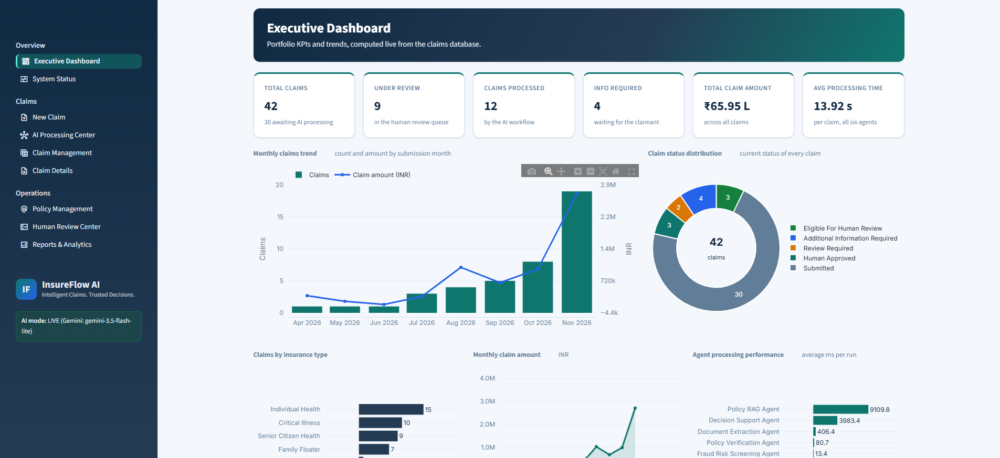

---

## Table of Contents

1. [Project Overview](#1-project-overview)
2. [Business Problem](#2-business-problem)
3. [Key Features](#3-key-features)
4. [Technology Stack](#4-technology-stack)
5. [System Architecture](#5-system-architecture)
6. [Agent Architecture](#6-agent-architecture)
7. [LangGraph Workflow](#7-langgraph-workflow)
8. [RAG Architecture](#8-rag-architecture)
9. [Database Design](#9-database-design)
10. [Installation Guide](#10-installation-guide)
11. [Environment Configuration](#11-environment-configuration)
12. [How to Run the Application](#12-how-to-run-the-application)
13. [How to Execute Tests](#13-how-to-execute-tests)
14. [Screenshots](#14-screenshots)
15. [Limitations](#15-limitations)
16. [Future Improvements](#16-future-improvements)

---


## 1. Project Overview

InsureFlow AI is a multi-agent insurance claims processing platform designed to streamline the health-insurance claim assessment workflow through intelligent automation, explainable recommendations, and human oversight.

The platform processes health-insurance claims through the following stages:

1. **Claim Submission:** A claimant or operator submits a claim along with supporting PDF documents, such as the claim form, hospital bill, discharge summary, and optional medical reports.
2. **Multi-Agent Processing:** A **LangGraph** workflow coordinates six specialised agents that process the claim using a shared state.
3. **Execution Tracking:** Each agent's inputs, outputs, execution duration, routing decisions, and actual LLM usage are recorded in the database to support traceability and auditing.
4. **Human Review:** The processed claim is sent to the **Human Review Center**, where the reviewer can examine the AI-generated recommendation, cited policy clauses, risk indicators, and reviewer checklist.
5. **Decision Recording:** An authorised reviewer records the final decision. The AI recommendation is preserved alongside the human decision, providing an auditable record of the assessment process.

### AI Operating Modes

InsureFlow AI supports two operating modes:

- **Demo Mode (No API Key Required):** The application runs using deterministic business rules, local embeddings, and OCR. This allows the complete workflow to be demonstrated without requiring an external AI API.
- **Gemini-Enhanced Mode:** When a valid `GOOGLE_API_KEY` is configured, Gemini is used for selected tasks where generative AI adds value:
  - Filling missing information during document extraction.
  - Generating explanations grounded in retrieved policy clauses.
  - Preparing decision-support summaries.
  - Generating embeddings for semantic policy retrieval.

The platform tracks actual LLM usage and indicates whether an LLM was called for each relevant execution. This helps distinguish deterministic processing from AI-assisted operations.

**Important:** InsureFlow AI provides decision support, not autonomous claim adjudication. Every claim requires human review before a final decision is recorded.


## 2. Business Problem

Health-insurance claims teams spend a significant amount of time performing repetitive administrative and verification tasks before they can focus on the actual claim assessment.

Common challenges include:

- **Manual document processing:** Reading multiple PDF documents and manually extracting or re-entering claim information.
- **Policy verification:** Checking policy status, waiting periods, coverage limits, and eligibility conditions.
- **Policy wording analysis:** Searching lengthy policy documents to identify relevant exclusions, coverage conditions, and clauses.
- **Data consistency checks:** Identifying duplicate invoices, mismatched amounts, and inconsistencies between submitted documents.
- **Audit and traceability:** Maintaining clear records of checks, findings, and decisions across the claim lifecycle.

These manual processes can be time-consuming, error-prone, and difficult to audit consistently.

### How InsureFlow AI Addresses the Problem

InsureFlow AI automates these **preparatory assessment tasks** using specialised agents, deterministic validation rules, and Retrieval-Augmented Generation (RAG).

Instead of making the claims officer perform every initial check manually, the platform presents:

- Extracted information from submitted documents.
- Policy verification results and relevant coverage conditions.
- Retrieved policy clauses with supporting references.
- Validation findings and potential inconsistencies.
- Explainable risk indicators.
- A structured recommendation and human-review checklist.

This allows claims officers to spend less time on repetitive checks and more time evaluating evidence and making informed decisions.

### Human-in-the-Loop Approach

In the regulated insurance domain, fully automated claim approvals or rejections can introduce significant legal, ethical, and operational risks.

InsureFlow AI therefore follows a **human-in-the-loop decision-support approach**:

- AI agents assist with document processing, verification, and evidence gathering.
- The platform provides recommendations rather than final decisions.
- Human reviewers examine the available evidence and record the final claim decision.
- The AI recommendation and human decision are retained together for auditability.

**The objective is not to replace claims officers, but to help them make more informed, consistent, and explainable decisions.**


## 3. Key Features

InsureFlow AI combines document intelligence, deterministic business rules, Retrieval-Augmented Generation (RAG), multi-agent orchestration, and human review into a single claims-processing platform.

| Area | Implemented Features |
|---|---|
| **Document Processing** | PyMuPDF-based PDF text extraction; RapidOCR (ONNX) fallback for scanned pages; document classification; field extraction across different label and date formats; cross-document conflict detection; and hospital bill line-item total verification. |
| **Policy Verification** | 10 deterministic and explainable verification rules covering policy existence, status, policyholder matching, product type, coverage period, waiting periods (with accident exemptions), hospitalisation coverage, sum insured and remaining balance, exclusions, and discharge after policy expiry. |
| **Policy RAG** | Clause-level chunking of policy PDFs; FAISS vector indexing; plan and category filtering; citations containing plan, clause, file, and page references; explicit `INSUFFICIENT_EVIDENCE` responses instead of unsupported conclusions; and rejection of Gemini-generated answers that cite clauses not retrieved by the system. |
| **Claim Validation** | Checks for required documents and fields, impossible or future dates, claimed versus billed amounts, inconsistencies between forms and supporting documents, duplicate invoices, length of stay, and late claim submission. |
| **Risk Screening** | 11 transparent risk indicators with fixed point values and a score ranging from 0–100. Uses neutral, explainable wording without personal attributes. Findings are presented as signals for further investigation, never as accusations. |
| **Decision Support** | Four permitted advisory outcomes: `ELIGIBLE_FOR_HUMAN_REVIEW`, `ADDITIONAL_INFORMATION_REQUIRED`, `POLICY_NOT_FOUND`, and `REVIEW_REQUIRED`. Provides reasons, required actions, a reviewer checklist, and evidence confidence. The `human_decision_required` flag is always `true`. |
| **Orchestration** | LangGraph `StateGraph` workflow with conditional routing for unknown policies, missing documents, invalid data, high-risk findings, and technical failures. Each workflow node records its execution details. |
| **Human Review** | Separate AI recommendation and human decision panels; role-based review rules (investigators cannot approve claims, and claims above ₹5 lakh require a senior reviewer); mandatory comments for rejection, information requests, and escalation; and protected final decision records. |
| **Dashboard** | Eight branded Streamlit pages plus a System Status page; interactive Plotly charts; database-driven metrics; and CSV export functionality. |
| **API** | FastAPI backend with Swagger UI and ReDoc documentation. Supports customer and policy management, multipart claim submission, document access, claim processing, status tracking, agent execution history, human reviews, analytics, and workflow graph access. Uses a consistent structured error response format. |
| **Security** | PDF signature, file-size, and encryption checks; safe file naming; upload size enforcement during streaming; environment-based secrets; no stack traces exposed to clients; and database transactions with rollback handling. |
| **Testing** | Pytest unit and integration tests covering document processing, policy scenarios, RAG, validation, fraud screening, decision support, workflow routing, database operations, API endpoints, and dashboard page rendering. |

## 4. Technology stack

| Layer | Technology |
|---|---|
| Language | Python 3.12 |
| Agents and LLM | LangChain 1.x, **LangGraph**, Google Gemini (`langchain-google-genai`) |
| RAG | FAISS (`faiss-cpu`), Gemini embeddings or local hashing embeddings, LangChain text splitters |
| Documents | PyMuPDF, RapidOCR + ONNX Runtime |
| Backend | FastAPI, Uvicorn, Pydantic v2 |
| Frontend | Streamlit (custom CSS theme), Plotly |
| Database | SQLite for local development, PostgreSQL for cloud deployment |
| Deployment | Render (separate Streamlit dashboard and FastAPI backend services) |
| Testing | Pytest, FastAPI TestClient, Streamlit AppTest |


## 5. System architecture

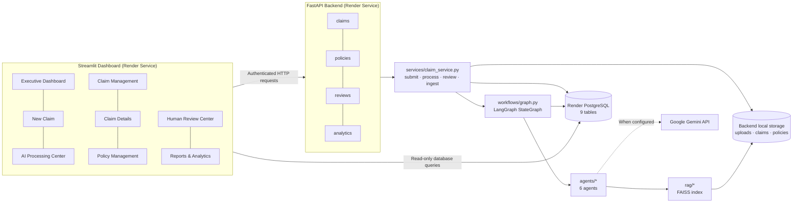

- **Separate deployment services.** The Streamlit dashboard and FastAPI backend are deployed as independent Render web services.
- **Shared database.** Both services connect to the same PostgreSQL database for application data.
- **Authenticated communication.** Dashboard-to-backend requests use API token authentication through the `X-API-Token` header.
- **Centralized business logic.** The API uses `services/claim_service.py` to handle claim submission, processing, reviews, validation and audit logging.
- **AI workflow.** LangGraph coordinates six specialized agents, with FAISS-based RAG and Google Gemini integration.
- **Document downloads.** The dashboard retrieves documents through an authenticated backend API endpoint because the two Render services have separate filesystems.
- **Storage limitation.** Uploaded documents currently use local backend storage. Render free-service filesystems are ephemeral, so uploaded files may not survive restarts or redeployments.

More detail: [docs/architecture.md](docs/architecture.md).

### Agent Execution Flow

The agents work together as part of the LangGraph workflow:

1. **Document Extraction:** Extracts relevant information from uploaded claim documents.
2. **Policy Verification:** Checks policy details, coverage and applicable conditions.
3. **Policy RAG:** Retrieves relevant policy information and provides supporting explanations.
4. **Claim Validation:** Validates claim information and identifies missing or inconsistent data.
5. **Fraud Risk Screening:** Evaluates predefined risk indicators using deterministic rules.
6. **Decision Support:** Combines agent outputs to generate a structured recommendation for human review.

Each agent returns a structured Pydantic result. The workflow combines these results to determine the next processing step and produce an auditable claim assessment.

**Important:** The system provides decision support, not autonomous claim approval or rejection. Final decisions require human review.


## 7. LangGraph workflow

LangGraph orchestrates the six specialized agents through a conditional workflow. Each agent processes the claim, updates the shared state, and records its execution details.

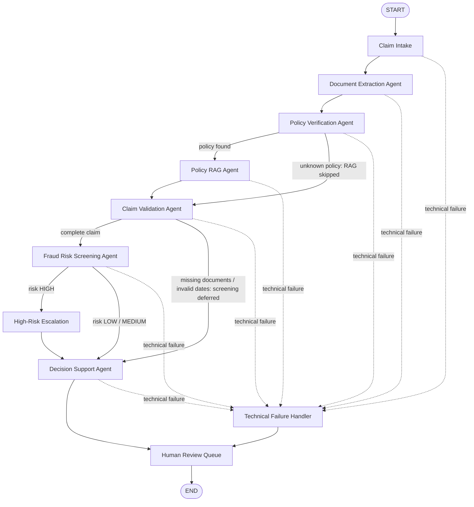

### Workflow Execution and Human Review

The workflow supports conditional routing based on policy verification, claim validation, and fraud risk assessment.

- Claims with missing documents or invalid dates can be routed for human review without proceeding to fraud screening.
- High-risk claims are escalated before reaching the human review queue.
- Technical failures are captured by the failure handler instead of terminating the workflow unexpectedly.
- Agent outputs, execution history, risk flags, and processing logs are persisted for traceability.
- The workflow generates a structured claim assessment for human review. It does not independently approve or reject insurance claims.

### Shared State

**Shared state** (`workflows/state.py`) maintains the information exchanged between workflow nodes:

- `claim_id`
- `customer_information`
- `uploaded_documents`
- `extracted_document_information`
- `policy_information`
- `policy_verification`
- `retrieved_policy_clauses`
- `claim_validation`
- `risk_assessment`
- `decision_support`
- `processing_status`
- `execution_history` (append-only reducer)
- `error_information` (append-only reducer)

### Node Wrapper

**Node wrapper** (`workflows/nodes.py`):

- Times each node execution.
- Records actual LLM usage.
- Catches exceptions and converts them into `error_information` with a `FAILED` status.
- Stores the next processing step with a plain-English reason.
- Ensures technical failures are routed to human review instead of unexpectedly crashing the workflow.

### Conditional Routing

- **Policy verification:** If a policy is found, the Policy RAG agent retrieves relevant clauses. If the policy is unknown, RAG is skipped.
- **Claim validation:** Complete claims proceed to fraud risk screening. Claims with missing documents or invalid dates have screening deferred.
- **Fraud screening:** High-risk claims are escalated. Low- and medium-risk claims proceed to decision support.
- **Waiting period and uncertain coverage:** These conditions are carried as flags and explained in routing reasons. The Decision Support agent converts them into `REVIEW_REQUIRED`.
- **Technical failure:** Workflow errors are captured and routed to the Human Review Queue.

### Persistence

**Persistence** (`workflows/persistence.py`) stores:

- Every agent output.
- Each workflow execution.
- Risk flags.
- Processing log entries.

This provides traceability of claim processing and supports later review.

### Running the Workflow from the Command Line

Run the following commands from the project root:

```bash
# Process one claim and print the execution path and timings
python -m workflows.graph CLM-202611-0025

# Process every claim
python -m workflows.graph --all

# Display the compiled workflow diagram
python -m workflows.graph --mermaid
```


## 8. RAG architecture

InsureFlow AI uses Retrieval-Augmented Generation (RAG) to retrieve relevant insurance policy clauses and provide evidence-backed explanations during claim assessment.

### RAG Workflow

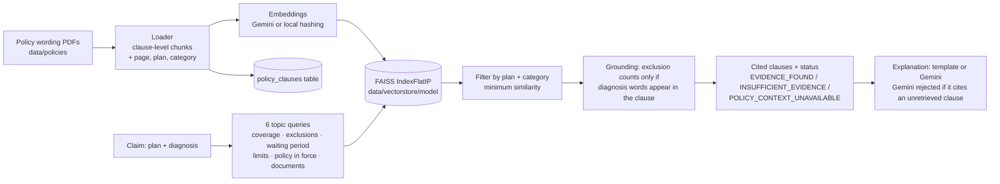

### Document Ingestion and Chunking

- Policy wording PDFs are loaded from `data/policies`.
- The wording PDFs are generated from the same product catalogue (`database/catalog.py`) as the deterministic rules, helping prevent contradictions between retrieval and rule-based processing.
- Documents are split into clause-level chunks, preserving metadata such as page number, plan, and category.
- Chunks are maintained as whole clauses, for example, `EXC-01 Cosmetic or aesthetic treatment`, so citations refer to complete, readable policy clauses.
- Unstructured uploads use recursive text splitting as a fallback.

### Embedding and Vector Storage

- Embeddings can be generated using Google Gemini or local hashing.
- FAISS `IndexFlatIP` is used for similarity-based retrieval.
- Each embedding model has its own index folder under `data/vectorstore/`.
- Gemini and local vectors are never mixed in the same index.
- A SHA-256 manifest tracks policy PDF changes and triggers automatic index rebuilding when a policy document changes.

### Retrieval and Evidence Grounding

For each claim, the system generates six topic-specific queries covering:

1. Coverage
2. Exclusions
3. Waiting period
4. Policy limits
5. Policy in force
6. Required documents

Retrieved clauses are filtered using the applicable plan, category, and minimum similarity threshold.

Additional grounding rules help prevent unsupported conclusions:

- Exclusion counts are considered only when diagnosis-related words appear in the retrieved clause.
- Only retrieved policy clauses can be used as supporting evidence.
- Each citation refers to an actual policy clause.
- If sufficient evidence is unavailable, the system does not invent policy information.

### Response Generation

The RAG agent produces cited clauses and one of the following statuses:

| Status | Meaning |
|---|---|
| `EVIDENCE_FOUND` | Relevant policy evidence was retrieved. |
| `INSUFFICIENT_EVIDENCE` | Retrieved information is not sufficient to support a conclusion. |
| `POLICY_CONTEXT_UNAVAILABLE` | Relevant policy context could not be retrieved. |

Explanations are generated using templates or Google Gemini when configured.

If Gemini references a clause that was not retrieved, its explanation is rejected to prevent unsupported citations.

**Core principle:** Policy clause text is copied from the source documents, never generated. When evidence is insufficient, the system communicates the limitation and requests human review.
```

This version preserves your original technical implementation and makes the ingestion, retrieval, grounding, and response-generation stages easier to explain in an interview.


## 9. Database design

InsureFlow AI uses a relational database to manage customers, insurance policies, claims, documents, agent executions, risk indicators, human reviews, and processing logs.

### Entity Relationship Diagram

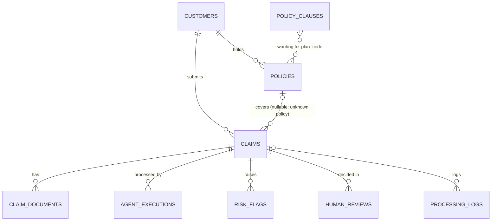

### Database Tables

| Table | Purpose |
|---|---|
| `customers` | Stores fictional insurance policyholder information. |
| `policies` | Stores plan, sum insured, policy term, waiting period, status, and exclusions. Includes CHECK constraints on status, type, dates, and amounts. |
| `claims` | Stores submitted claim information, processing statuses, risk information, and JSON output from each agent. |
| `claim_documents` | Stores document metadata, including file path, document type, size, page count, and SHA-256 hash for duplicate detection. |
| `agent_executions` | Stores one record per workflow node per run, including status, execution time, LLM usage, input and output summaries, routing information, and errors. |
| `policy_clauses` | Stores indexed insurance policy wording and mirrors the FAISS retrieval index. |
| `risk_flags` | Stores explainable risk indicators associated with each claim. |
| `human_reviews` | Stores reviewer information, role, decision, comments, and the AI recommendation snapshot. |
| `processing_logs` | Maintains an audit trail of claim submissions, workflow executions, reviews, and administrative activities. |

### Database Access and Transaction Management

InsureFlow AI follows the **Repository Pattern** to separate database operations from business logic.

- **Repository layer:** `database/repository.py` provides centralized database access.
- **Transactional sessions:** Database operations use transactional sessions to maintain data consistency.
- **Data validation:** Status columns use string values with CHECK constraints to enforce permitted values.
- **JSON storage:** JSON columns store structured agent outputs and claim-processing information.
- **Database compatibility:** The schema supports SQLite for local development and PostgreSQL for cloud deployment by configuring `DATABASE_URL`.

### Database Design Benefits

- **Data organization:** Separates customer, policy, claim, document, and review information into related tables.
- **Traceability:** Maintains agent execution history and processing logs.
- **Auditability:** Preserves AI recommendation snapshots alongside human review decisions.
- **Data integrity:** Uses relationships and database constraints to maintain consistency.
- **Extensibility:** Supports additional agents, risk indicators, and review workflows without redesigning the entire database.

**Design principle:** AI-generated recommendations and human review decisions are stored separately so that every claim assessment remains traceable and auditable.


## 10. Installation guide

### Requirements

- Python 3.12
- Git
- Visual Studio Code (recommended)
- Internet connection for installing Python dependencies

No additional system packages are required. OCR uses RapidOCR installed through pip.

### Clone the Repository

**macOS / Linux**

```bash
git clone https://github.com/danish-git-hub/InsureFlow-AI.git
cd InsureFlow-AI
```

Create and activate a virtual environment:

```bash
python3.12 -m venv .venv
source .venv/bin/activate
```

**Windows (PowerShell)**

```powershell
git clone https://github.com/danish-git-hub/InsureFlow-AI.git
cd InsureFlow-AI
```

Create and activate a virtual environment:

```powershell
py -3.12 -m venv .venv
.venv\Scripts\Activate.ps1
```

If PowerShell blocks script execution, run:

```powershell
Set-ExecutionPolicy -Scope Process -ExecutionPolicy Bypass
```

Then activate the virtual environment again.

### Install Dependencies

Run on macOS, Linux, or Windows:

```bash
pip install -r requirements.txt
```

### Configure Environment Variables

Create your local environment file.

**macOS / Linux**

```bash
cp .env.example .env
```

**Windows (PowerShell)**

```powershell
Copy-Item .env.example .env
```

Update `.env` with the required configuration. Add your Google Gemini API key if you want to enable Gemini-powered features.

Never commit `.env` or expose API keys and passwords in your repository.

### Initialize the Application

```bash
python run.py setup
```

The setup command performs the following operations:

- Creates and initializes the database.
- Generates synthetic customer, policy, and claim data.
- Generates sample claim PDFs and policy wording documents.
- Builds the FAISS vector index.
- Runs the six-agent workflow on the generated claims.

**Important:** The setup command initializes and generates demo data. Run it when setting up a fresh local environment. Avoid rerunning it on an existing environment without checking its database and data-reset behavior.

### Start the Application

After setup completes, start the application:

```bash
python run.py all
```

Open the following URLs in your browser:

| Component | URL |
|---|---|
| Streamlit Dashboard | http://localhost:8501 |
| FastAPI Backend | http://localhost:8000 |
| FastAPI Swagger Documentation | http://localhost:8000/docs |

### First-Time OCR Initialization

On first use, RapidOCR loads its bundled ONNX models. Initial loading may take additional time depending on your system.


## 11. Environment configuration

InsureFlow AI uses environment variables to configure AI services, database connections, API communication, file uploads, and application logging.

### Environment Variables

| Variable | Default / Example | Meaning |
|---|---|---|
| `GOOGLE_API_KEY` | *(empty)* | Google Gemini API key. Empty means demo mode with no LLM calls. |
| `GEMINI_MODEL` | `gemini-3.5-flash lite` | Chat model used for structured outputs. |
| `GEMINI_EMBEDDING_MODEL` | `models/gemini-embedding-001` | Embedding model used for RAG when a key is configured. |
| `DATABASE_URL` | `sqlite:///data/insureflow.db` | SQLAlchemy database connection URL. PostgreSQL is used in cloud deployment. |
| `API_BASE_URL` | `http://127.0.0.1:8000` | FastAPI backend URL used by the dashboard. |
| `API_ACCESS_TOKEN` | *(configured separately)* | Token used to authenticate dashboard-to-backend API requests. |
| `APP_ACCESS_PASSWORD` | *(configured separately)* | Password used to protect dashboard access. |
| `MAX_UPLOAD_MB` | `10` | Maximum allowed upload size per file, in MB. |
| `LOG_LEVEL` | `INFO` | Application logging level. |

### Local Development

1. Copy `.env.example` to `.env`.
2. Configure the variables required for your local environment.
3. Add `GOOGLE_API_KEY` if you want to enable Gemini-powered features.
4. Configure `DATABASE_URL` for SQLite or another supported database.
5. Start the application using the installation instructions.

### Render Deployment Configuration

The deployed application uses environment variables configured separately in Render for each service.

- **Dashboard service:** Streamlit application configuration, backend API URL, API access token, and dashboard access password.
- **API service:** Database connection, Gemini configuration, API access token, and application settings.
- **Database:** PostgreSQL connection is configured through `DATABASE_URL`.

The deployed Gemini configuration uses:

```env
GEMINI_MODEL=gemini-3.5-flash-lite
GEMINI_EMBEDDING_MODEL=models/gemini-embedding-001
```

Actual secret values, including API keys, passwords, and access tokens, must be configured securely in the deployment environment.

### Security Notes

- Secrets are read from environment variables or the local `.env` file.
- The `.env` file is excluded from Git using `.gitignore`.
- Never commit API keys, passwords, database credentials, or access tokens to GitHub.
- Dashboard access is password-protected.
- Dashboard-to-backend API communication uses the `X-API-Token` authentication header.
- The sidebar displays the current AI operating mode.

**AI operating modes:**

- **Demo mode:** Gemini is not called when `GOOGLE_API_KEY` is empty.
- **Gemini mode:** Gemini-powered features are enabled when a valid API key is configured.


## 12. How to run the application

### Start the Application Locally

The application can be started using a single command:

```bash
python run.py all
```

This starts:
- FastAPI backend at `http://127.0.0.1:8000`
- Streamlit dashboard at `http://localhost:8501`

### Run Services Separately

**Start FastAPI:**

```bash
python run.py api
```

- Swagger documentation: http://127.0.0.1:8000/docs
- ReDoc documentation: http://127.0.0.1:8000/redoc

**Start Streamlit Dashboard:**

```bash
python run.py dashboard
```

- Dashboard: http://localhost:8501

### Access the Live Deployment

InsureFlow AI is deployed on Render using separate dashboard and API services.

- **Live Dashboard:** https://insureflow-dashboard.onrender.com
- **Backend API:** Configured as a separate Render service.
- **Database:** PostgreSQL hosted on Render.

The deployed dashboard communicates with the backend through authenticated API requests.

### Demo Script (Approximately 3 Minutes)

Follow this sequence to demonstrate the application's main capabilities:

1. **Executive Dashboard:** Show live KPIs, claim statistics, and charts.
2. **New Claim:** Click *Fill demo claim*, then *Submit claim*. Matching PDFs are generated and the claim is processed through FastAPI.
3. **AI Processing Center:** Demonstrate the actual LangGraph execution path, timings, inputs, outputs, and routing reasons.
4. **Claim Details:** Open an exclusion claim (for example, scenario `POLICY_EXCLUSION`) and show the cited clause `EXC-01`, including its page number and source file.
5. **Human Review Center:** Show how the duplicate-invoice claim is escalated and displayed first. Try recording *Approved* as an Investigator to demonstrate the role-based permission rule.
6. **Reports & Analytics:** Demonstrate agent performance metrics and CSV export.

### Useful CLI Tools

**Run all six agents without database writes:**

```bash
python -m agents.decision_agent CLM-202611-0025
```

**Test policy retrieval using RAG:**

```bash
python -m rag.retriever --query "cosmetic surgery" --plan IHS
```

**Reset and rebuild the local database:**

```bash
python -m database.init_db --reset
```

**Note:** The database reset command may replace existing local demo data. Use it only when you intend to rebuild the local database.

### API Example

Retrieve the processing status of a claim:

```bash
curl -s http://127.0.0.1:8000/api/v1/claims/CLM-202611-0025/status
```

### Synthetic Test Scenarios

The application includes synthetic claims designed to demonstrate different insurance claim-processing scenarios.

| Scenario | Claims | Expected recommendation | Detected by |
|---|---:|---|---|
| Valid policy and claim | 14 | `ELIGIBLE_FOR_HUMAN_REVIEW` | All checks pass |
| Expired policy | 2 | `REVIEW_REQUIRED` | Policy agent: status rule |
| Unknown policy number | 2 | `POLICY_NOT_FOUND` | Policy agent (RAG skipped) |
| Claim exceeds sum insured | 2 | `REVIEW_REQUIRED` | Policy agent: sum insured rule |
| Missing documents | 3 | `ADDITIONAL_INFORMATION_REQUIRED` | Validation agent |
| Incomplete waiting period | 2 | `REVIEW_REQUIRED` | Policy agent, with the RAG waiting-period clause |
| Policy exclusion | 2 | `REVIEW_REQUIRED` | Policy agent and RAG exclusion clause |
| Duplicate invoice | 2 | `REVIEW_REQUIRED` | Validation and Fraud agents (high-risk escalation) |
| Invalid hospitalisation dates | 2 | `ADDITIONAL_INFORMATION_REQUIRED` | Validation agent |
| Inconsistent claim amount | 2 | `REVIEW_REQUIRED` | Validation and Fraud agents |

### Synthetic Dataset Summary

The project includes the following sample data:

| Dataset | Count |
|---|---:|
| Customers | 55 |
| Policies | 63 |
| Claims | 33 |
| Claim PDFs | 125 |
| Image-only scanned PDFs (for OCR testing) | 3 |
| Policy wordings | 5 |
| Policy clauses | 87 |

All records and documents are synthetic and are intended for demonstration and testing purposes.


## 13. How to execute tests

InsureFlow AI includes unit and integration tests covering document extraction, policy verification, RAG retrieval, claim validation, fraud risk assessment, decision support, LangGraph workflows, database operations, API endpoints, and dashboard functionality.

### Run the Test Suite

Run all tests using:

```bash
python run.py test
```

Alternatively, use pytest directly:

```bash
python -m pytest -q
```

For a more detailed test report:

```bash
python -m pytest -v
```

### Test Environment

- Tests use temporary databases and folders.
- Tests do not modify the project's actual `data/` directory.
- Gemini integration paths use injected fake models.
- No Google API key or external network connection is required.
- Tests cover successful responses, invalid outputs, citation validation, decision-language restrictions, and API failures.

### Test Coverage

| Area | Test files |
|---|---|
| PDF extraction and OCR fallback | `tests/unit/test_document_agent.py`, `tests/unit/test_document_storage.py`, `tests/integration/test_seeded_documents.py` |
| Policy verification | `tests/unit/test_policy_agent.py`, `tests/integration/test_policy_scenarios.py` |
| RAG retrieval | `tests/unit/test_rag_pipeline.py`, `tests/unit/test_rag_agent.py`, `tests/integration/test_rag_scenarios.py` |
| Validation and duplicate detection | `tests/unit/test_validation_agent.py` |
| Risk assessment (including a fairness test) | `tests/unit/test_fraud_agent.py` |
| Decision support | `tests/unit/test_decision_agent.py`, `tests/integration/test_agent_pipeline.py` |
| LangGraph execution and routing | `tests/unit/test_workflow_routing.py`, `tests/integration/test_workflow.py` |
| Database | `tests/unit/test_database.py`, `tests/unit/test_synthetic_data.py` |
| API, human review workflow, error handling | `tests/integration/test_api.py` |
| Dashboard pages | `tests/integration/test_dashboard.py` |

### Gemini Testing

Gemini-related execution paths are tested using injected fake models rather than requiring live API calls.

The tests cover:

- Valid structured model output.
- Invalid or unretrieved citations.
- Rejection of unsupported decision language.
- API failures and error handling.
- Application behavior without a configured Gemini API key.

### Test Results

Run the test suite locally to obtain the current results:

```bash
python -m pytest -q
```

The test count and execution time may vary as the project evolves. Only report the latest test results after executing the test suite.


## 14. Screenshots

The following screenshots showcase the InsureFlow AI application, including its dashboard, multi-agent processing workflow, policy intelligence, human review capabilities, and system monitoring.

### Application Dashboard and Claim Processing

| Executive Dashboard | New Claim Submission |
|---|---|
|  | 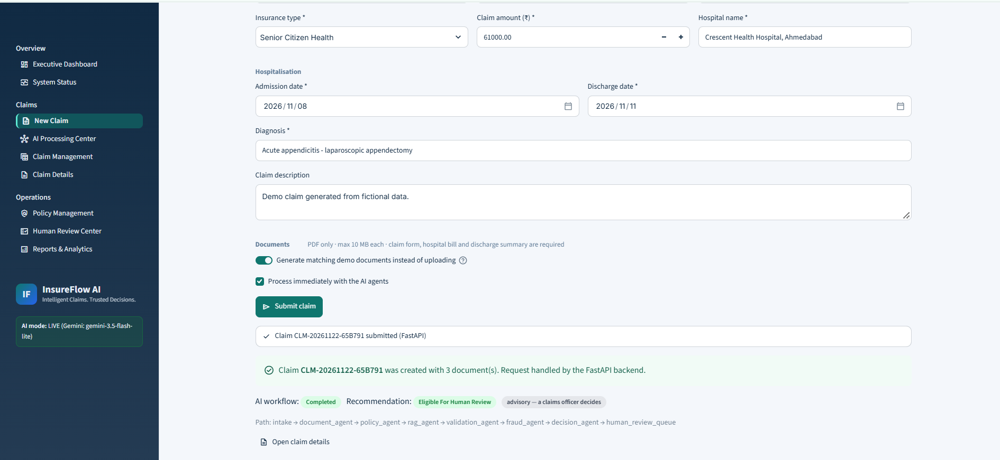 |

| AI Processing Center | Claim Details & Policy Clauses |
|---|---|
| 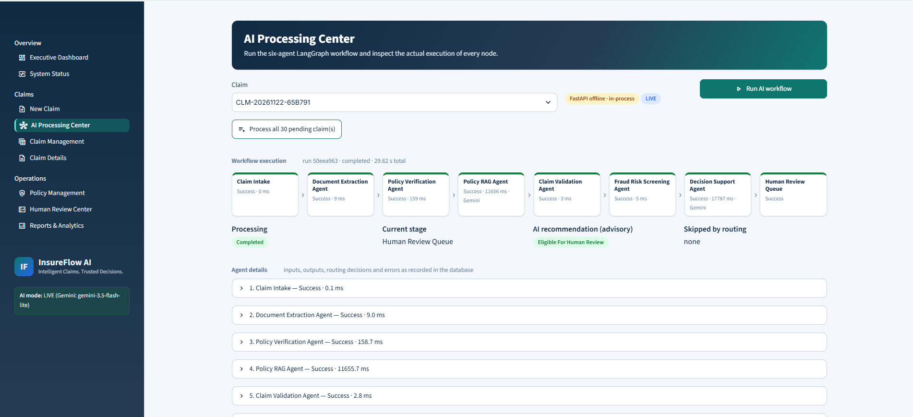 | 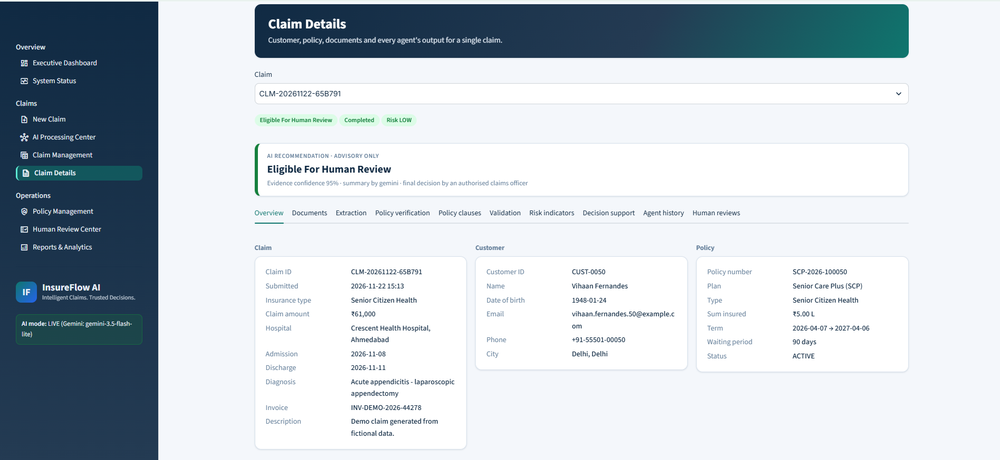 |

### Policy Intelligence and Human Review

| Human Review Center | Policy RAG |
|---|---|
| 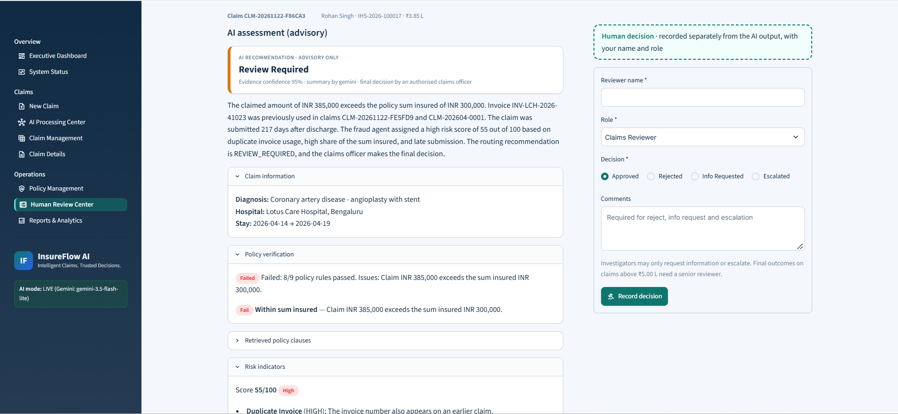 | 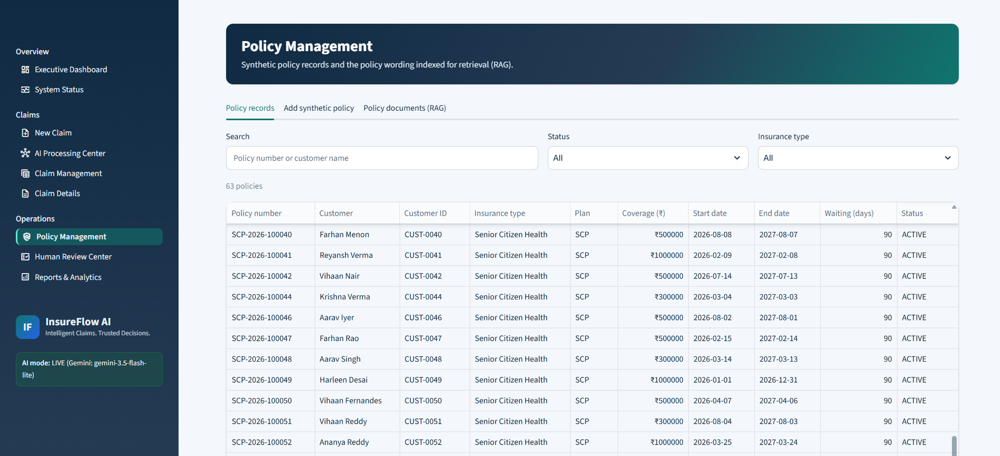 |

### Analytics and System Monitoring

| Reports & Analytics | System Status |
|---|---|
| 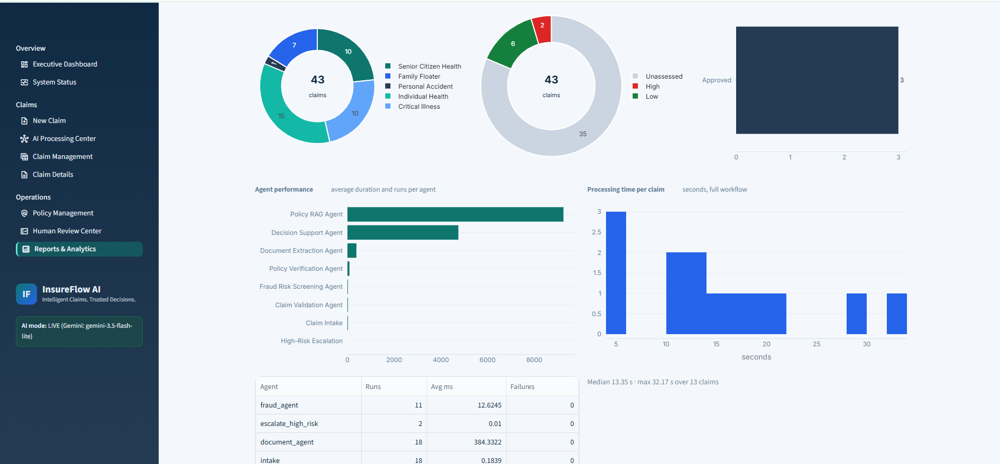 | 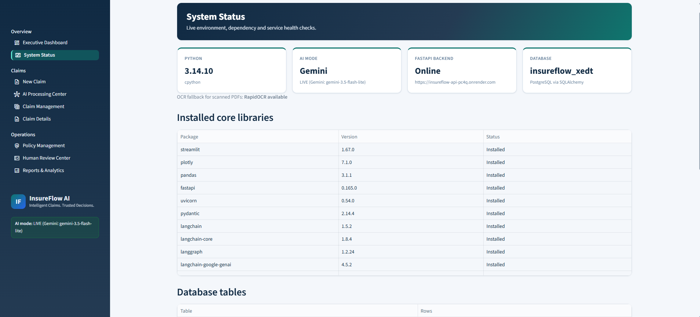 |

---

## 15. Limitations

InsureFlow AI is an academic and demonstration prototype. The following limitations should be considered when evaluating its capabilities.

### AI and RAG Limitations

- **Demo-mode retrieval is lexical.** Local hashing embeddings primarily match vocabulary rather than semantic meaning. Similarity thresholds and exact-term grounding help reduce unsupported matches. Gemini embeddings can improve semantic retrieval when configured.
- **Gemini dependency:** Gemini-powered features require a valid Google API key and network connectivity. Model responses may vary, and structured outputs are validated before use.
- **Extraction accuracy:** Document extraction targets the PDF layouts used in this project. Unfamiliar hospital templates, scanned documents, or unusual date formats may result in missing fields. Gemini gap-filling can help, but extracted information still requires validation.
- **Keyword-based exclusion detection:** The system checks catalogued exclusions using rule-based matching. Unusual diagnosis wording or complex medical terminology may require human interpretation.

### Insurance Business Logic Limitations

- **Policy history:** Lapse and cancellation dates are not currently stored. As a result, the system cannot fully evaluate historical policy status for earlier admission dates.
- **Risk assessment:** Fraud risk indicators are illustrative, rule-based heuristics, not a trained or independently validated fraud detection model.
- **Recommendation scope:** AI recommendations are intended to support human reviewers. The system does not autonomously approve or reject insurance claims.

### Deployment and Infrastructure Limitations

- **Document storage:** Uploaded documents currently use local backend storage. Render free web services have ephemeral filesystems, so uploaded PDFs may not survive service restarts or redeployments.
- **Separate service filesystems:** The Streamlit dashboard and FastAPI backend run as independent Render services. Documents are downloaded through authenticated backend API endpoints rather than direct dashboard filesystem access.
- **Database:** PostgreSQL is used for the deployed application, while SQLite is available for local development. The current deployment is intended for demonstration, not production-scale workloads.
- **Processing:** The current application does not provide a production-grade distributed background processing system or enterprise workflow orchestration infrastructure.

### Security Limitations

- **Authentication:** Dashboard access is password-protected, and dashboard-to-backend API requests use token authentication. However, the application does not implement enterprise identity management or a complete production-grade authorization system.
- **Role management:** Reviewer roles and permissions are implemented within the prototype. They are not integrated with an external identity provider.
- **Data:** The application uses synthetic customer, policy, and claim information. It should not be used to process real customer or medical records.

### Production Improvements

A production deployment would require:

- Persistent object storage for uploaded documents.
- Enterprise authentication and server-enforced role-based access control.
- Distributed background processing and reliable workflow recovery.
- More comprehensive policy interpretation and medical terminology handling.
- Validation of fraud indicators against representative real-world datasets.
- Security reviews, monitoring, backup, and disaster recovery.

**Important:** InsureFlow AI demonstrates multi-agent orchestration, document processing, RAG, and human-in-the-loop claim assessment. It is a working prototype, not a production-ready insurance claims management system.


## 16. Future improvements

The following improvements are planned for future versions of InsureFlow AI:

- **Authentication and authorisation:** OAuth2 / SSO integration with server-side role management, along with an audit-log viewer.
- **Background processing:** Celery or RQ for asynchronous claim processing, live progress updates through LangGraph streaming, and LangGraph checkpointing for resumable workflow runs.
- **Advanced RAG:** Calibrated Gemini embeddings, hybrid BM25 + vector retrieval, and a cross-encoder re-ranker to improve policy clause retrieval.
- **Document intelligence:** Layout-aware extraction for tables and multi-page bills, along with handwriting OCR support.
- **Infrastructure and deployment:** PostgreSQL with Alembic migrations, S3-compatible document storage, Docker Compose, and GitHub Actions CI to run the test suite automatically.
- **Recommendation quality measurement:** A feedback loop using human review decisions to measure recommendation quality, including the precision of `ELIGIBLE` recommendations against subsequent human rejections.

---

### Responsible AI summary

InsureFlow AI is designed as a human-in-the-loop decision-support prototype.

- **No autonomous claim decisions:** The system never approves or rejects claims. It produces advisory outcomes only, and a human decision is always required.
- **Explainable risk indicators:** Risk indicators represent observable signals, not accusations of fraud. Personal attributes are never used for risk scoring.
- **Grounded policy explanations:** Policy clauses are retrieved and cited from source documents, never invented. When evidence is insufficient, the system reports the limitation and routes the claim for human review.
- **Transparent AI usage:** Demo results are clearly labelled. Each agent execution record indicates whether an LLM was actually called.

---
